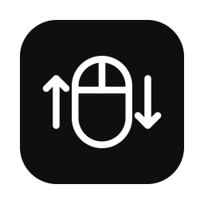

<p align="center">
  
</p>

<h1 align="center">ScrollFix</h1>

<p align="center">Natural scrolling on the trackpad, classic scrolling on the mouse.</p>

---

## The problem

macOS has **one** natural scrolling setting, shared by every pointing device.
Natural scrolling feels right on a trackpad (content follows your fingers) but
wrong on a mouse wheel, so if you use both you end up opening System Settings
every time you switch.

## What ScrollFix does

ScrollFix is a tiny menu bar app that keeps each device the way you expect:

- **Trackpad:** natural scrolling, exactly as macOS does it.
- **Mouse wheel:** classic scrolling, scroll down to move down.

It works with both devices at the same time, so there is nothing to toggle
when you switch. No Dock icon, no window, no settings to tune.

## Install

With Homebrew:

```sh
brew tap LKTeloeken/scroll-fix https://github.com/LKTeloeken/scroll-fix
brew install --cask scroll-fix
```

From source (needs the Xcode Command Line Tools):

```sh
git clone https://github.com/LKTeloeken/scroll-fix
cd scroll-fix
make install
```

## Setup

1. Open ScrollFix. It appears as a mouse icon in the menu bar.
2. Allow it in **System Settings → Privacy & Security → Accessibility**.
   If it is not listed, click **+** and pick `/Applications/ScrollFix.app`.
   It starts working a couple of seconds later, no restart needed.
3. Turn **natural scrolling on** in System Settings → Trackpad.

ScrollFix adds itself to your login items on first launch.

## Menu

| Item | What it does |
| --- | --- |
| Status line | Shows whether the mouse is being inverted, paused, or waiting for permission |
| Invert Mouse Scrolling | Pause or resume without quitting |
| Open at Login | Start ScrollFix when you log in |
| Open Accessibility Settings… | Shown until the permission is granted |
| Quit ScrollFix | Stops it; scrolling goes back to the system setting |

The icon is dimmed whenever ScrollFix is not inverting.

## How it works

A `CGEventTap` sees every scroll event before apps do. Trackpads send
continuous (pixel) events, while a mouse wheel sends discrete line ticks; only
the discrete ones get their direction flipped. If natural scrolling is turned
off in the system, ScrollFix leaves everything alone.

The whole app is about 200 lines of Swift in [`Sources/`](Sources).

## Limitations

- Mice that fake smooth scrolling (Magic Mouse, or some vendor drivers with
  smooth scrolling turned on) send continuous events too, so they are treated
  like a trackpad.
- The app is ad-hoc signed, not notarized. macOS ties the Accessibility grant
  to the signature, so after an update you may need to remove ScrollFix from
  the Accessibility list and allow it again. The Homebrew cask clears the
  download quarantine so Gatekeeper lets it open.

## Development

```sh
make build                    # build/ScrollFix.app (universal)
make install                  # copy to /Applications and launch
swift scripts/make-icon.swift # regenerate the icon from Resources/AppIcon.svg
```

Pushing a `v*` tag builds `ScrollFix.zip` with GitHub Actions and attaches it
to a release; the cask always installs the latest release.

## Uninstall

```sh
brew uninstall --cask scroll-fix   # or: make uninstall
```
